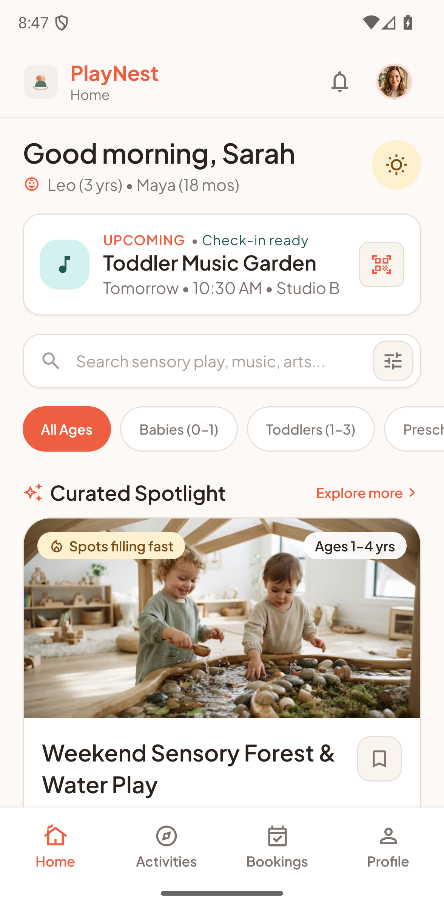
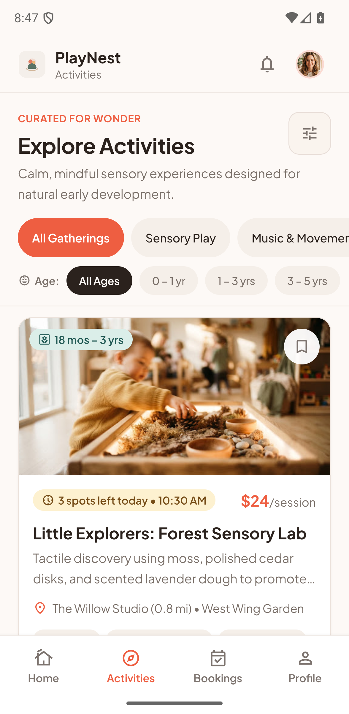
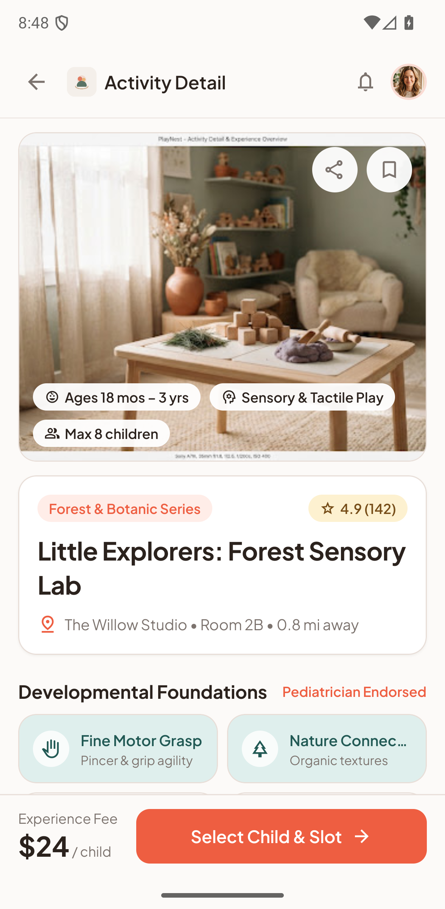
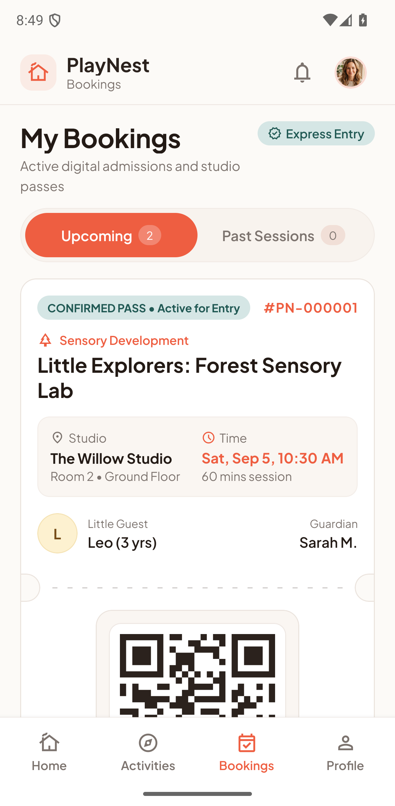
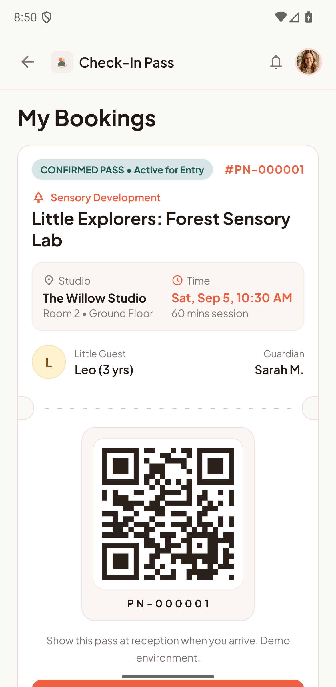
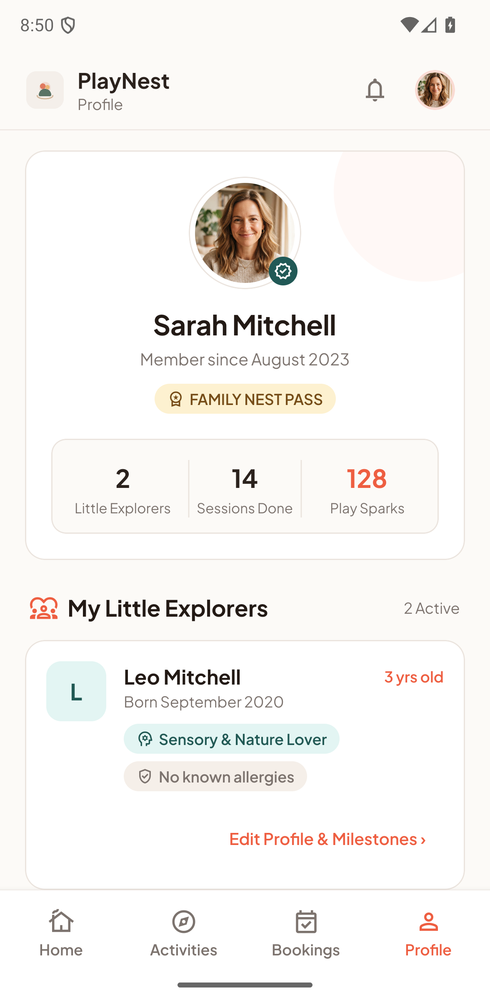

# PlayNest

PlayNest is an Android app for parents to find and book activities for their children at one fictional activity center. Recommendations, bookings and check-in passes are stored locally on the device.

## Screenshots

<table>
  <tr>
    <td align="center"><br><sub>Home</sub></td>
    <td align="center"><br><sub>Activities</sub></td>
  </tr>
  <tr>
    <td align="center"><br><sub>Activity detail</sub></td>
    <td align="center"><br><sub>Bookings</sub></td>
  </tr>
  <tr>
    <td align="center"><br><sub>Check-in pass</sub></td>
    <td align="center"><br><sub>Profile</sub></td>
  </tr>
</table>

## Requirements

- Node.js and npm
- Android SDK, Java, and a physical Android device or emulator
- For a USB device, Android Debug Bridge (`adb`) with USB debugging enabled

## Setup and run

Install dependencies with `npm ci`, then start the Metro development server with `npm start`.

Build, install and open the Android debug app on a connected device:

```bash
npm run android -- --device <serial>
```

If several devices are connected, list them first with `adb devices -l`.

The app package is `com.enriquezwend.playnest`. After `./android/gradlew app:assembleDebug` succeeds, the debug APK is written to `android/app/build/outputs/apk/debug/app-debug.apk`. Install it with:

```bash
adb -s <serial> install -r android/app/build/outputs/apk/debug/app-debug.apk
```

Debug builds load JavaScript from Metro. For a standalone APK that does not need Metro, use the `preview` EAS profile. EAS authentication and signing access is required and is not stored in this repository:

```bash
npx eas build --platform android --profile preview
```

## Design reference

The UI is translated from the Stitch designs in `docs/stitch_playnest_mobile_app_design/`. Their HTML, screenshots, images and logo are the visual reference. Screen mapping and verification evidence are in [`docs/mobile/STITCH_PARITY.md`](docs/mobile/STITCH_PARITY.md).

## Demo data

Demo data is fictional: the family, activities, prices and sessions. Availability and bookings are local to each installation and are not shared between devices.

To reset a device, open **Profile** → **Reset local demo data** → **Reset demo**. This removes bookings stored on that device and recreates the demo session set.

## Scope

- Demo sign-in only. There is no live authentication, payment, cancellation, membership, notifications, or staff workflow.
- The check-in pass is presentation-only and is not an admission mechanism.
- Capacity is not shared or server-authoritative.

## Verification

Run the source checks from the project root:

```bash
npm run test:domain
npx tsc --noEmit
npm run lint
node .agents/skills/impeccable/scripts/detect.mjs --json src/app src/components
```
